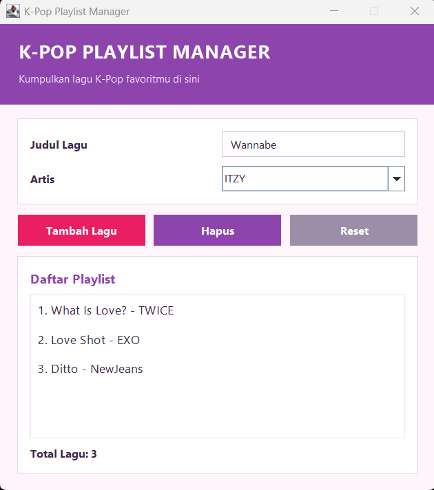
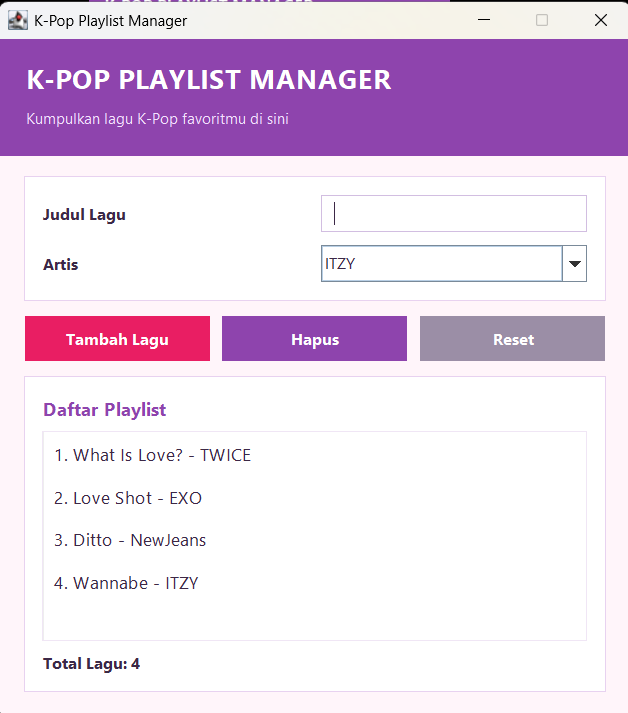
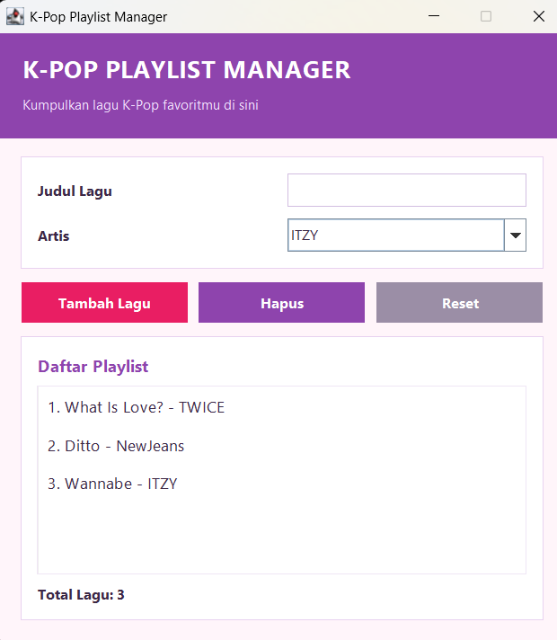

# K-Pop Playlist Manager

## 5 Komponen Utama GUI yang Digunakan

1. Top-level Container Class
JFrame digunakan sebagai Top-level Container Class yang berfungsi sebagai jendela utama aplikasi K-Pop Playlist Manager. Pada program ini, class KpopPlaylistGUI menggunakan extends JFrame, sehingga seluruh komponen GUI dapat ditempatkan di dalam jendela tersebut. JFrame juga digunakan untuk mengatur judul, ukuran, posisi, dan perilaku window ketika ditutup.

2. Intermediate Container Class
JPanel digunakan sebagai Intermediate Container Class untuk mengelompokkan dan mengatur komponen-komponen GUI. Pada program ini terdapat beberapa JPanel, seperti panel header, panel form input, panel tombol, dan panel daftar playlist. Penggunaan JPanel membuat tampilan aplikasi menjadi lebih terstruktur dan memudahkan pengaturan layout pada setiap bagian.

3. Atomic Component Class
Atomic Component Class yang digunakan dalam aplikasi ini terdiri dari JLabel, JTextField, JComboBox, JButton, dan JList. JLabel digunakan untuk menampilkan teks seperti judul dan keterangan. JTextField digunakan untuk menerima input judul lagu. JComboBox digunakan untuk memilih artis K-Pop. JButton digunakan untuk menjalankan aksi Tambah Lagu, Hapus, dan Reset. Sedangkan JList digunakan untuk menampilkan daftar lagu yang terdapat dalam playlist.

4. Layout Classes
Aplikasi ini menggunakan dua Layout Class, yaitu BorderLayout dan GridLayout. BorderLayout digunakan untuk mengatur posisi komponen berdasarkan area seperti NORTH, CENTER, dan SOUTH, contohnya untuk menempatkan header dan panel utama aplikasi. GridLayout digunakan untuk menyusun komponen dalam bentuk baris dan kolom, seperti pada form input judul lagu dan artis serta bagian tombol.

5. Event Listener
ActionListener digunakan untuk menangani interaksi pengguna dengan tombol pada aplikasi. Setiap tombol didaftarkan menggunakan addActionListener(). Program kemudian melakukan override terhadap method actionPerformed(ActionEvent e) untuk menentukan tindakan yang dilakukan ketika tombol ditekan. Tombol Tambah Lagu digunakan untuk menambahkan lagu ke playlist, tombol Hapus digunakan untuk menghapus lagu yang dipilih, sedangkan tombol Reset digunakan untuk mengosongkan input dan mengembalikan pilihan artis ke kondisi awal.

## Screenshot

